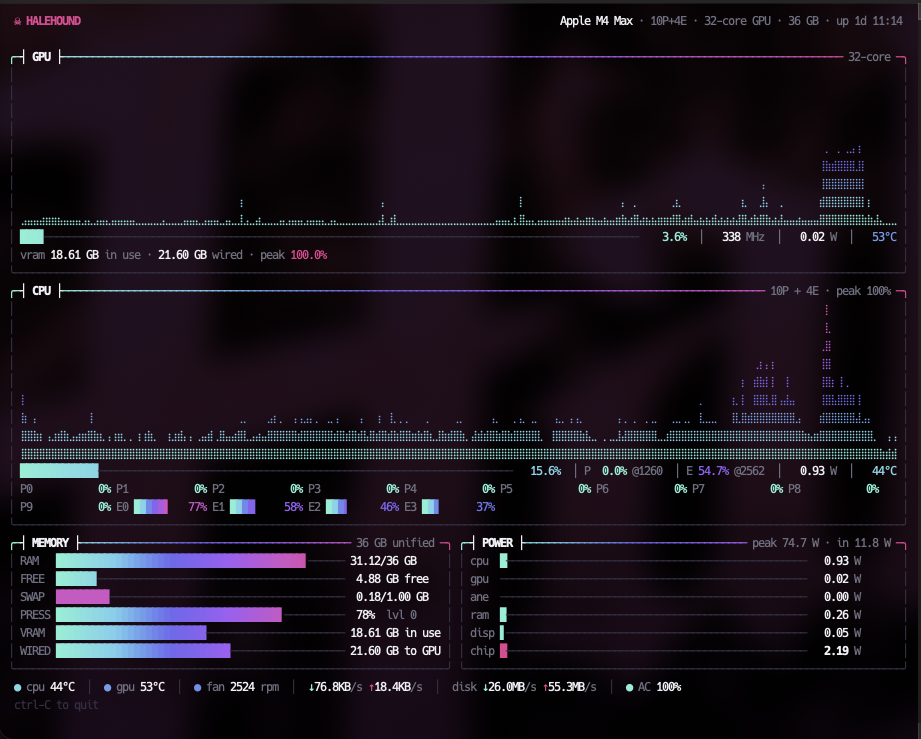

# hhgpu

A terminal system monitor for Apple Silicon. The whole chip on one screen.



## What it shows

- GPU load, clock, VRAM in use and VRAM wired, with a history graph
- Every P and E core on its own bar, plus the aggregate and both clocks
- Memory used, free, swap, pressure, and what is wired to the GPU
- All six power rails: cpu, gpu, ane, ram, display and package
- Fans, temperatures, net and disk rates, battery

One file. No build step, no pip packages, no venv. It runs `macmon` and
draws what macmon reports.

## Install

```sh
brew install macmon
curl -fsSL -o hhgpu https://raw.githubusercontent.com/JesseCHale/hhgpu/main/hhgpu
chmod +x hhgpu
./hhgpu
```

Drop it anywhere on your `PATH` to keep it.

## Usage

```
hhgpu              live dashboard (ctrl-C to quit)
hhgpu -s           one-shot snapshot, prints and exits
hhgpu -i 250       sample interval in ms (default 1000)
hhgpu -m           hand off to the raw macmon TUI
hhgpu -V           version

--size 120x40      force a render size, for screenshots or piping
--color MODE       auto (default) | true | 256 | none
--demo             synthetic load, to see the look without running a job
```

## Requirements

- An Apple Silicon Mac. macmon reads arm64-only counters.
- [macmon](https://github.com/vladkens/macmon) on your `PATH`.
- Python 3. The one Apple ships is fine. No pip packages, no venv.

If `python3` offers to install developer tools, say yes, or run
`xcode-select --install`. Homebrew needs them anyway.

## Notes

Graphs are braille: 2 samples wide and 4 levels tall per character cell, so
a 60x6 graph holds 120 samples at 24 levels of vertical resolution. Colour
runs teal at the floor to hot pink at the ceiling, so height and hue say the
same thing and a pegged GPU reads as a pink wall at a glance.

24-bit colour is used when `COLORTERM` advertises it, otherwise the ramp is
quantised to the xterm-256 palette. `NO_COLOR` and `--color none` give a
working monochrome dashboard. Colour is not suppressed when stdout is a
pipe, because piping to a file is how you screenshot it.

The power bars are scaled for laptop wattage. On a Mac Studio or Mac Pro
the cpu, gpu and chip bars will read full until the session has seen some
variation. The watt figures are always correct.

Everything else adapts to the machine: core counts, GPU cores, memory and
fans are read at runtime, and a fanless Mac simply drops the fan readout.

## Credits

All metrics come from [macmon](https://github.com/vladkens/macmon) by
vladkens (MIT), invoked as a subprocess. hhgpu contains no macmon code.

## License

MIT. See the header of `hhgpu`.

"HaleHound" is a trademark of Jesse Hale. The MIT grant covers this source
only. HaleHound firmware is proprietary, all rights reserved, and is not
MIT licensed.
